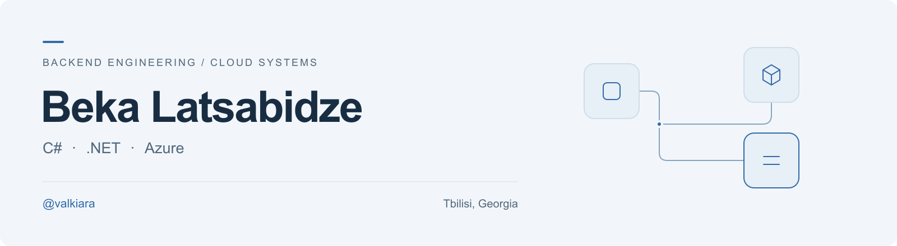

<picture>
  <source media="(prefers-color-scheme: dark)" srcset="assets/banner-dark.png">
  <source media="(prefers-color-scheme: light)" srcset="assets/banner-light.png">
  
</picture>

I build backend systems and event-driven services with C#, .NET, and Azure, with a focus on document automation and business integrations.

### Open-source contributions

Selected merged pull requests:

| Project | Contribution | Pull requests |
| :--- | :--- | :--- |
| [.NET Extensions](https://github.com/dotnet/extensions) | Evaluation context serialization and streaming model ID fixes | [#7869](https://github.com/dotnet/extensions/pull/7869), [#7816](https://github.com/dotnet/extensions/pull/7816) |
| [ASP.NET Core Docs](https://github.com/dotnet/AspNetCore.Docs) | YARP direct forwarding documentation and runnable transform examples | [#37779](https://github.com/dotnet/AspNetCore.Docs/pull/37779) |
| [Material UI](https://github.com/mui/material-ui) | Autocomplete filtering performance improvement | [#49295](https://github.com/mui/material-ui/pull/49295) |
| [Ant Design](https://github.com/ant-design/ant-design) | Mentions callback documentation correction | [#59484](https://github.com/ant-design/ant-design/pull/59484) |
| [Recharts](https://github.com/recharts/recharts) | Reference element label documentation and examples | [#7919](https://github.com/recharts/recharts/pull/7919) |

[View all public merged pull requests →](https://github.com/search?q=is%3Apr+author%3Avalkiara+is%3Amerged+is%3Apublic+-user%3Avalkiara&type=pullrequests)

### Technologies I work with

| Area | Technologies |
| :--- | :--- |
| Backend | C#, .NET, ASP.NET Core |
| Messaging | MassTransit, Azure Service Bus |
| Document processing | Azure AI Document Intelligence, Azure OpenAI |
| Data & storage | Azure Cosmos DB, Azure Blob Storage |
| Infrastructure | Docker, .NET Aspire, GitHub Actions |
| Integrations | Microsoft Graph, MailKit, SAP Business One |
| Testing | xUnit, Moq |

### My open-source projects

- **[QuotaLatch](https://github.com/valkiara/quotalatch)** — Experimental shared budgets for AI workers, built with Python and PostgreSQL.
- **[SAPB1.SLFramework](https://github.com/valkiara/SAPB1.SLFramework)** — C# tooling for SAP Business One Service Layer integrations.

---

[Explore my repositories →](https://github.com/valkiara?tab=repositories)
